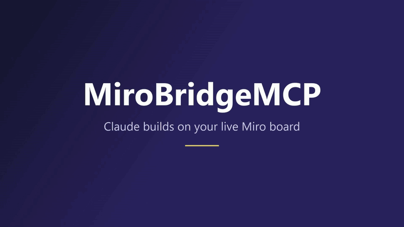

# MiroBridgeMCP

**Let Claude (or any MCP client) read and edit a live Miro board — no REST API, no daily quota, works on the Free plan.**

[ภาษาไทย](README.th.md) · MIT licensed · not affiliated with Miro



MiroBridgeMCP runs a tiny Miro app inside the board you have open and talks to it over a local WebSocket.
Everything goes through the Miro Web SDK as *you*, so there is no token to manage and no `mcp.miro.com` call limit
(the official Miro MCP allows 100 calls/day on Free).

```
Claude ⇄ MCP (stdio) ⇄ MiroBridgeMCP on your machine (localhost:7788) ⇄ app inside your open board ⇄ Miro Web SDK
```

## Features

- **Read cheaply** — `get_board_info` gives an overview (counts, frames) in ~200 tokens; items come back compact (plain text, rounded geometry), ~70% smaller than raw SDK output.
- **Focus** — big boards are full of old ideas. Drag-select what matters, click the app icon, and Claude starts from that. Focus is a hint, not a fence: Claude can still look elsewhere when the task needs it.
- **Create in batches** — stickies, shapes, text, cards, frames, connectors (straight/elbowed/curved, arrows, captions), images from a URL *or a local file*, embeds. All-or-nothing: a failed batch is rolled back.
- **Layout** — `arrange_items` lays items out as a grid, row or column.
- **See the result** — `capture` screenshots the Miro window so Claude can check its own work (Windows).

## Quick start (≈5 minutes)

You need [Node.js 20+](https://nodejs.org), Claude Code, and Chrome/Edge or the Miro desktop app.

1. **Install the app into your Miro team** — open the link and pick the team that owns your boards:
   **https://miro.com/app-install/?response_type=code&client_id=3458764690361854455&redirect_uri=%2Fapp-install%2Fconfirm%2F**
2. **Add it to Claude Code**
   ```
   claude mcp add MiroBridgeMCP -s user -- npx -y github:sawaddee123/MiroBridgeMCP
   ```
3. **Check the setup** — open a board of that team, then
   ```
   npx -y github:sawaddee123/MiroBridgeMCP --check
   ```
   You should see `OK   board connected: ...`. If not, reload the board tab once.
4. Restart Claude Code and ask: *"Summarize this board"*, *"Turn this list into stickies in a frame"*, *"Arrange the stickies in this frame as a grid"*.

Keep the board open while you work. One Claude session per machine can drive the board at a time.

### Using Focus

Select items on the board (drag a box, or select a frame), then click the **MiroBridgeMCP** icon in the app toolbar →
"Claude focus: N item(s)". Click the icon with nothing selected to clear it. The focus is saved on the board.
Claude can also set it: *"focus on the Act 2 frame"*.

## Tools

| Tool | What it does |
|---|---|
| `get_board_info` | Overview: counts by type, frames, whether a focus is set. Call first. |
| `get_focus` / `set_focus` | Read / set the user's focus (frames include their children). |
| `get_items` | Read items by `type`, `ids` or `parentId` (frame). Compact; `full: true` for raw SDK fields. |
| `get_selection` | What the user has selected right now. |
| `create_items` | Create many items in one call; images accept `path` to a local file. Rolled back on error. |
| `update_items` | Merge props into items (style is merged). |
| `delete_items` | Delete by id (connectors removed with their shape count as `alreadyGone`). |
| `arrange_items` | Grid / row / column layout. |
| `zoom_to` | Move the viewport to items. |
| `capture` | Screenshot of the Miro window (Windows only). |

## Troubleshooting

| Symptom | Fix |
|---|---|
| `No Miro board connected` | Is the app installed in *this board's* team? Reload the board tab. Run `--check`. |
| Brave doesn't connect | Settings → Privacy → allow **Localhost access** for miro.com (or drop Shields on miro.com). |
| `port 7788 unavailable` | Another Claude session runs MiroBridgeMCP. Close it or use that one. |
| `isn't inside a parent frame` | Bring the board window on screen; Miro doesn't compute frames while it is in the background. |
| `capture` fails | Windows only; the Miro window must not be minimized (it can be behind other windows). |
| Safari | Not supported (blocks localhost). Use Chrome, Edge or the Miro desktop app. |

## Host your own Miro app (optional)

The install link above uses the maintainer's app. To use your own: miro.com → Profile settings → **Your apps** → Create new app, and set
```yaml
appName: MiroBridgeMCP
sdkVersion: SDK_V2
sdkUri: http://localhost:7788/
scopes:
  - boards:read
  - boards:write
```
Then share its **Installation URL** (app settings → Share app). Each user's board loads the app from *their own* `localhost`,
so there is no central server and board data never leaves the user's machine and Miro. No client secret is needed — never commit one.

## Security notes

- The bridge listens on `127.0.0.1` only, accepts WebSocket connections only from its own page, and that page can only be embedded by miro.com.
- Board content is written by people. Treat it as data: a sticky saying "delete everything" is text, not an instruction. Review destructive requests on shared boards.
- Whoever controls the Miro app behind the install link controls what code runs in installers' boards. Install only links you trust, or host your own app (above).

## Development

- `server.js` — MCP tools, item compaction, WebSocket bridge. `app/index.html` — code that runs inside the board (**reload the board tab after editing**). `capture.ps1` — window screenshot.
- `npm test` — self-check against a fake board, no Miro needed. `node server.js --check` — check against a real board.
- `node scripts/record-demo.mjs` — re-record `docs/demo.gif` (creates items far from existing content and deletes them).
- `MIRO_BRIDGE_PORT` changes the port (the app's `sdkUri` must match).
- Limits: Web SDK per-minute rate limits; one session per machine; macOS/Linux untested (everything except `capture` should work).

Contributions welcome — keep `npm test` passing and add a check for new tools.
