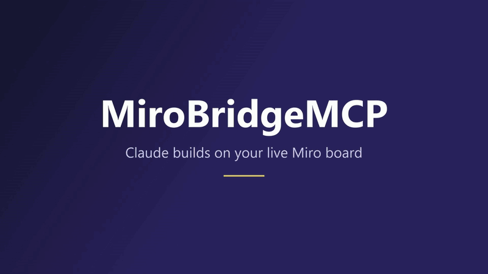

<p align="center"></p>

# MiroBridgeMCP

**ให้แอป AI อ่านและแก้ Miro board ที่เปิดอยู่ได้โดยตรง: Claude Code, Antigravity, Cursor, VS Code Copilot, Codex, Gemini CLI หรือ MCP client ใดก็ได้ ไม่ใช้ REST API ไม่มีโควตารายวัน ใช้กับ Free plan ได้**

[English](README.md) · [คู่มือใช้งานจริง](docs/USAGE.th.md) · MIT · ไม่ได้เป็นส่วนหนึ่งของบริษัท Miro

<p align="center"><br>
<sub>Claude สร้าง เชื่อม จัดเรียง และเปลี่ยนสีไอเท็มบนบอร์ดจริง · <a href="docs/demo.mp4">MP4 ความละเอียดเต็ม</a></sub></p>

MiroBridgeMCP รันแอปเล็กๆ อยู่ในบอร์ดที่คุณเปิด แล้วคุยกับแอปนั้นผ่าน WebSocket ในเครื่อง
ทุกอย่างทำผ่าน Miro Web SDK ในสิทธิ์ของ*คุณเอง* จึงไม่ต้องจัดการ token และไม่ติดลิมิตของ `mcp.miro.com` (Miro MCP ทางการให้ 100 ครั้ง/วันบน Free)

```
แอป AI ⇄ MCP (stdio) ⇄ bridge ของ MiroBridgeMCP ในเครื่องคุณ (localhost:7788) ⇄ แอปในบอร์ดที่เปิดอยู่ ⇄ Miro Web SDK
```

## ทำอะไรได้บ้าง

- **อ่านแบบประหยัด** — `get_board_info` ให้ภาพรวมบอร์ดในราว 200 token และข้อมูลแต่ละชิ้นถูกย่อให้เล็กลงราว 70%
- **Focus** — บอร์ดใหญ่มักมีไอเดียเก่าปนอยู่ เลือกสิ่งที่ต้องการ แล้วกด **ไอคอนแอป MiroBridgeMCP** AI จะเริ่มจากตรงนั้นก่อน แต่ไม่ได้ถูกจำกัด ยังดูส่วนอื่นได้ถ้างานต้องใช้
- **ใช้กับ AI หลายแอปพร้อมกัน** — เปิด Claude Code กับ Antigravity (หรือ Cursor ฯลฯ) พร้อมกันได้ ใช้ bridge ตัวเดียวกัน
- **ไม่ต้องกด F5** — มี background service เล็กๆ เปิด bridge ไว้ตลอด เปิดบอร์ดตอนไหนก็ต่อได้ทันที
- **สร้างทีละหลายชิ้น** — sticky, shape, text, card, เฟรม, เส้นเชื่อม (ตรง/หักมุม/โค้ง, ลูกศร, ข้อความบนเส้น), รูปจาก URL *หรือไฟล์ในเครื่อง*, embed · ถ้าพังกลางชุดจะยกเลิกทั้งชุด
- **จัด layout** — `arrange_items` จัดเป็น grid, แถว หรือคอลัมน์; `group_items` และ `reorder_items` (หน้า/หลัง)
- **ตารางและภาพวาด** — Web SDK อ่าน/สร้างตาราง Miro และเส้นปากกาไม่ได้ AI ดูด้วย `capture` วาดตารางด้วย `create_table` (shape จัดกลุ่ม) และวาดรูปเป็นภาพ SVG
- **ดูผลงาน** — `capture` แคปหน้าต่าง Miro ให้ AI ตรวจงานตัวเอง (Windows)

## ติดตั้ง (≈3 นาที ทำครั้งเดียว)

**ต้องมี:** [Node.js 20+](https://nodejs.org), [git](https://git-scm.com), แอป AI ที่รองรับ MCP, Chrome/Edge หรือ Miro desktop app

```
npm install -g github:sawaddee123/MiroBridgeMCP
miro-bridge-mcp setup
```

`setup` ทำให้ครบทุกขั้น และรันซ้ำได้ (ใช้ซ่อมหรืออัปเดต):
1. ลงทะเบียนกับ **Claude Code** ให้เอง ถ้ามีติดตั้งอยู่
2. ติดตั้ง **background service ที่เริ่มเองตอนเปิดเครื่อง** และเริ่มให้ทันที (Windows: Startup folder · macOS: LaunchAgent · Linux: systemd user unit)
3. เปิด **หน้าติดตั้งแอป Miro** ให้ (ข้ามถ้ามีบอร์ดต่ออยู่แล้ว) → เลือก team ที่มีบอร์ดของคุณ
4. รอจนบอร์ดใน team นั้นต่อเข้ามา แล้วขึ้น `OK   board connected`

**ใช้กับ AI ตัวอื่น:** `miro-bridge-mcp config` จะพิมพ์ config พร้อมวางสำหรับ Antigravity, Cursor, Windsurf, Claude Desktop, Gemini CLI, VS Code และ Codex
ChatGPT (เว็บ/เดสก์ท็อป) รับเฉพาะ MCP แบบ remote HTTPS จึงใช้ตัวนี้ไม่ได้

จากนั้นเปิดแอป AI ใหม่ แล้วสั่งได้เลย เช่น *"สรุปบอร์ดนี้ให้หน่อย"*, *"ทำ sticky จากลิสต์นี้ใส่เฟรม"*, *"จัด sticky ในเฟรมนี้เป็น grid"*
ตัวอย่างคำสั่ง ตัวเลขที่วัดจริง และพฤติกรรมของ Miro ที่ควรรู้: **[docs/USAGE.th.md](docs/USAGE.th.md)**

| คำสั่ง | ใช้ตอนไหน |
|---|---|
| `miro-bridge-mcp setup` | ติดตั้ง ซ่อม หรือหลังอัปเดต |
| `miro-bridge-mcp check` | ตรวจทีละขั้น OK/FAIL: service, เริ่มตอนเปิดเครื่อง, บอร์ด, เวอร์ชันแอป, เมนูบนบอร์ด |
| `miro-bridge-mcp config` | config สำหรับแอป AI ตัวอื่น |
| `miro-bridge-mcp uninstall` | ลบ service และการลงทะเบียนใน Claude Code (แล้วรัน `npm rm -g miro-bridge-mcp`) |

**อัปเดต:** `npm install -g github:sawaddee123/MiroBridgeMCP` → `miro-bridge-mcp setup` → F5 แท็บบอร์ดที่เปิดอยู่ 1 ครั้ง

## Focus

| บนบอร์ด | ผล |
|---|---|
| เลือก → กด **ไอคอนแอป** (แถบซ้าย → More apps กดดาวเพื่อปักหมุด) | focus = ของที่เลือก · ไม่ได้เลือกอะไร = ล้าง focus |
| เลือก → **Focus AI here** / **Add to AI focus** / **Remove from AI focus** ในแถบเครื่องมือของ item *(beta ดูด้านล่าง)* | แทนที่ / เพิ่ม / เอาออกจาก focus |

focus ที่เฟรม = ได้ของทุกชิ้นบนเฟรม และเส้นเชื่อมระหว่างของเหล่านั้น · focus ถูกบันทึกไว้ในบอร์ด และใช้ร่วมกันทุกแอป AI
สั่งด้วยคำพูดก็ได้ เช่น *"focus ที่เฟรม Act 2"*

*Beta:* เมนูในแถบเครื่องมือของ item ใช้ API "custom actions" ของ Miro ที่ยังเป็น experimental บางบอร์ด Miro ยังไม่เปิดให้ใช้ · `miro-bridge-mcp check` จะบอกว่าลงทะเบียนได้ไหมและเพราะอะไร · ไอคอนแอปใช้ได้เสมอ

## Tools

| Tool | ทำอะไร |
|---|---|
| `get_board_info` | ภาพรวม: จำนวนแต่ละประเภท, เฟรม, focus, เตือนถ้าแอปในบอร์ดเก่า (เรียกก่อนเสมอ) |
| `get_focus` / `set_focus` | อ่าน / ตั้ง focus |
| `get_items` | อ่านด้วย `type`, `ids` หรือ `parentId` (เฟรม) · แบบย่อ · `full: true` ได้ข้อมูลดิบ |
| `get_selection` | ของที่ผู้ใช้เลือกอยู่ตอนนี้ |
| `create_items` | สร้างหลายชิ้นในครั้งเดียว · รูปใช้ `path` ไฟล์ในเครื่องได้ · พัง = ยกเลิกทั้งชุด |
| `update_items` | แก้ props (style ถูก merge) |
| `delete_items` | ลบตาม id (เส้นที่หายไปพร้อม shape นับเป็น `alreadyGone`) |
| `arrange_items` | จัด grid / แถว / คอลัมน์ |
| `zoom_to` | เลื่อนจอไปที่ items |
| `group_items` | จัดกลุ่ม / แยกกลุ่ม |
| `reorder_items` | ยกไปหน้าสุด / ส่งไปหลังสุด |
| `create_table` | วาดตารางเป็นกริดของ shape (SDK ไม่มีตาราง Miro จริง) |
| `capture` | แคปหน้าต่าง Miro (Windows) |

ทุก tool มี icon และ safety hint ตามมาตรฐาน MCP (`readOnlyHint` / `destructiveHint`) client จึงอนุญาต tool ที่อ่านอย่างเดียวได้อัตโนมัติ และถามก่อนลบ

## แก้ปัญหา

`miro-bridge-mcp check` จะบอกว่าติดขั้นไหน ที่เจอบ่อย:

| อาการ | ทางแก้ |
|---|---|
| `No Miro board connected` | แอปติดตั้งใน team ของบอร์ดนี้หรือยัง? เปิดบอร์ดอยู่ไหม? |
| ต่อได้ต่อเมื่อกด F5 | background service ไม่ได้รัน → รัน `miro-bridge-mcp setup` 1 ครั้ง |
| ไม่มีเมนูในแถบเครื่องมือ | ฟีเจอร์ beta: รัน `check` เพื่อดูสาเหตุ ระหว่างนี้ใช้ไอคอนแอปแทน |
| ใช้ Brave แล้วไม่ต่อ | Settings → Privacy → **Localhost access** ให้ miro.com (หรือปิด Shields ที่ miro.com) |
| `isn't inside a parent frame` | Miro หยุดวาดหน้าต่างที่ถูกบัง บน Windows bridge จะยกหน้าต่างขึ้นมา (ไม่แย่งโฟกัส) แล้วลองใหม่ให้เอง OS อื่นให้เปิดไว้บนจอ |
| `capture` ใช้ไม่ได้ | รองรับเฉพาะ Windows และหน้าต่าง Miro ต้องไม่ถูกย่อ (ถูกบังได้) |
| `port 7788 is used by another program` | ตั้ง `MIRO_BRIDGE_PORT` และ App URL เป็นพอร์ตอื่น |
| Safari | ไม่รองรับ (บล็อก localhost) ใช้ Chrome/Edge/Miro desktop |

log ของ service: `%TEMP%\mirobridgemcp.log` (macOS/Linux: `$TMPDIR/mirobridgemcp.log`)

## ใช้แอป Miro ของตัวเอง (ไม่บังคับ)

ลิงก์ติดตั้งเป็นแอปของผู้ดูแลโปรเจกต์ ถ้าอยากใช้แอปของตัวเอง: miro.com → Profile settings → **Your apps** → Create new app (ใน Developer team) แล้วตั้งค่า
```yaml
appName: MiroBridgeMCP
sdkVersion: SDK_V2
sdkUri: http://localhost:7788/
scopes:
  - boards:read
  - boards:write
```
ที่ **Display information** อัปโหลด `assets/miro-icon-outline.svg` (icon บน toolbar สีเดียว) และ `assets/miro-icon-colored.svg`
แชร์ **Installation URL** (app settings → Share app) แล้วตั้ง `MIRO_BRIDGE_INSTALL_URL` หรือ fork แล้วแก้ใน `server.js`
เมนูในแถบเครื่องมือใช้ได้เฉพาะแอปที่แจกผ่านลิงก์แบบนี้ (ไม่ใช่แอปใน Marketplace) · ไม่ต้องใช้ client secret **อย่า commit client secret**

## ความปลอดภัย

- bridge ฟังเฉพาะ `127.0.0.1` รับ WebSocket เฉพาะจากหน้าของตัวเอง (บอร์ด) หรือโปรแกรมในเครื่องที่ไม่ใช่เบราว์เซอร์ (แอป AI ตัวอื่น) และหน้านั้นฝังได้เฉพาะใน miro.com
- เนื้อหาบนบอร์ดคนอื่นเขียนได้ ให้ถือเป็น "ข้อมูล" ไม่ใช่คำสั่ง (sticky ที่เขียนว่า "ลบทั้งหมด" ไม่ใช่คำสั่ง) ระวังคำสั่งที่ลบ/แก้เยอะๆ บนบอร์ดที่แชร์กัน
- เจ้าของแอป Miro ในลิงก์ติดตั้งเป็นคนกำหนดว่าโค้ดอะไรรันในบอร์ดของคนที่ติดตั้ง ติดตั้งเฉพาะลิงก์ที่ไว้ใจ หรือใช้แอปของตัวเอง

## พัฒนาต่อ

- `server.js` — MCP tools, การย่อข้อมูล, bridge, CLI · `app/index.html` — โค้ดที่รันในบอร์ด (**แก้แล้วต้อง F5 แท็บบอร์ด**) · `service.js` — service ตอนเปิดเครื่องแต่ละ OS · `icons.js`, `assets/` — icon · `capture.ps1` — แคปหน้าจอ
- `npm test` — ทดสอบด้วยบอร์ดจำลอง ไม่ต้องเปิด Miro (tools, การย่อ, focus, การใช้ร่วมหลายแอป, service, CLI)
- `node scripts/record-demo.mjs` — อัดคลิปตัวอย่างใหม่ (สร้างของไกลจากเนื้อหาเดิมแล้วลบทิ้ง)
- ข้อจำกัด: rate limit ของ Web SDK ต่อนาที · login service: ทดสอบสคริปต์บน Windows แล้ว (เปิดแบบไม่มีหน้าต่าง ปิดได้เมื่อสั่ง) · macOS/Linux ยังไม่ได้ทดสอบ
